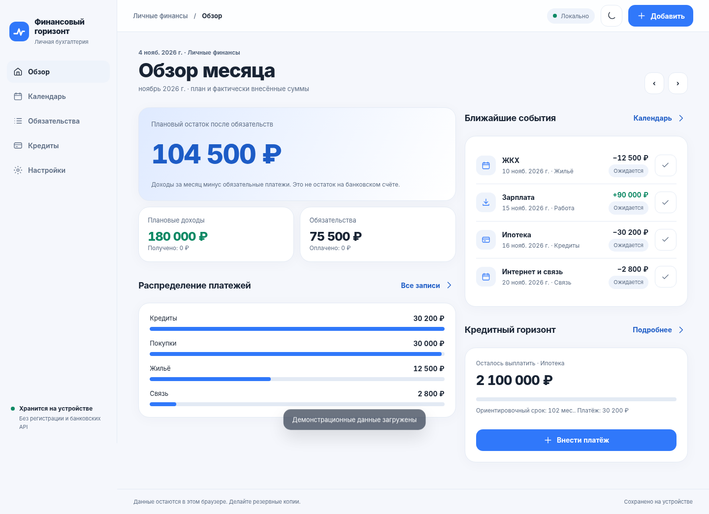
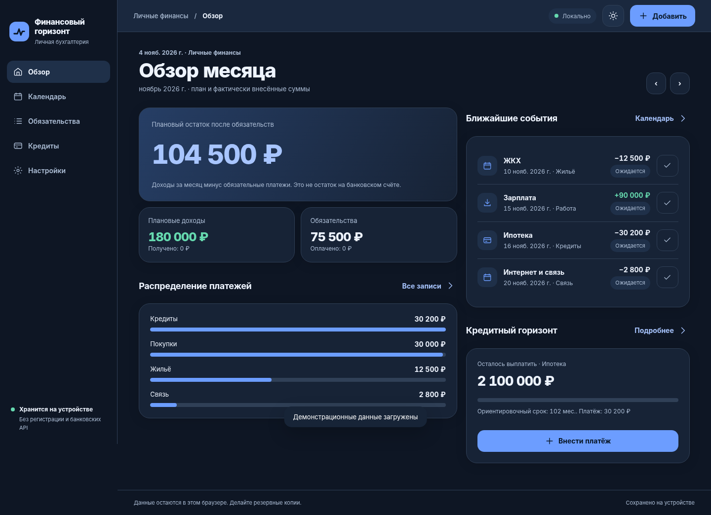
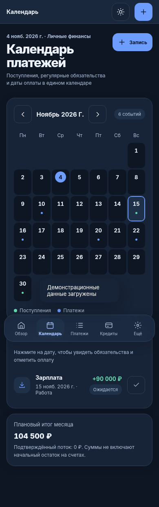
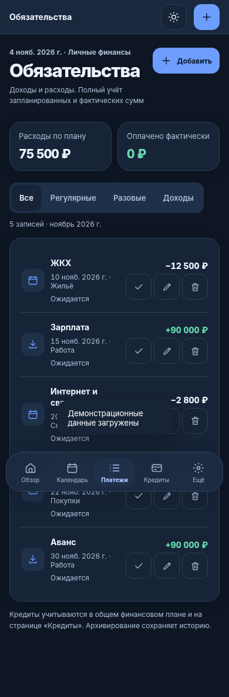

<picture>
  <source media="(prefers-color-scheme: dark)" srcset="assets/brand/logo-dark.svg">
  
</picture>

<h1>Your finances. A clearer horizon.</h1>

Track income, expenses, recurring payments, and loans in one place. 
A responsive web app and installable PWA - no bank connection or mandatory sign-up.

  <a href="https://fin-horizon.mikemoore.top/?guest=1"><strong>Try guest mode</strong></a>
  &nbsp;·&nbsp;
  <a href="#features">Features</a>
  &nbsp;·&nbsp;
  <a href="#quick-start">Run locally</a>
  &nbsp;·&nbsp;
  <a href="README.md">Русский</a>

  
   
  React 19 · TypeScript · Vite · PWA · IndexedDB · FastAPI

---

## See it in action

A responsive interface with light and dark modes. Screenshots use demonstration data.

<table>
  <tr>
    <td align="center" width="50%">
      
       Overview · light mode
    </td>
    <td align="center" width="50%">
      
       Overview · dark mode
    </td>
  </tr>
  <tr>
    <td align="center">
      
       Calendar · mobile
    </td>
    <td align="center">
      
       Payments · mobile
    </td>
  </tr>
</table>

## Features

| | What you can do |
| --- | --- |
| **Budget overview** | Track income, expenses, categories, planned amounts, and actual payments. |
| **Payment calendar** | See upcoming obligations; record full or partial payments and undo mistaken entries. |
| **Recurring transactions** | Plan one-off and repeating income and expenses. |
| **Loans** | Track outstanding balances and estimate the impact of early repayments by reducing the term or monthly payment. |
| **Imports** | Preview compatible XLSX worksheets, detect duplicates, and import CSV loan schedules for reference. |
| **Encrypted backups** | Export and restore data using an AES-256-GCM encrypted file. |
| **Installable PWA** | Use light/dark themes and access locally stored records offline after the app shell has been loaded. |

Entries can be edited, archived, and restored. Sample financial data is loaded **only when explicitly requested**.

## Privacy by design - and its boundaries

Financial Horizon follows a **local-first** model:

- Financial records remain in **IndexedDB in the current browser, profile, and origin**. They are not uploaded to the server, and there are no banking integrations.
- **Sign-up is optional.** Guest mode works without an account. A separate email authentication service exists but is currently restricted; [security acceptance #51](https://github.com/MikeMoore1337/financial-horizon/issues/51) is required before public registration.
- An account **does not synchronize finances across devices**. The authentication backend stores account/session information, not the ledger.
- Downloadable backups are encrypted. **Data inside IndexedDB is not encrypted by the application**; protect your browser profile/device and create backups regularly.
- Service Worker caching covers the application shell, **not** the financial ledger.

> **Loan projections are estimates**, not official bank repayment schedules. Actual interest calculations, fees, and payment dates may differ.

## Quick start

Explore the [live guest experience](https://fin-horizon.mikemoore.top/?guest=1), or build and serve the application locally with Vite (serving raw source HTML is no longer supported):

~~~bash
git clone https://github.com/MikeMoore1337/financial-horizon.git
cd financial-horizon
npm ci
npm run build
python3 -m http.server 8765 --bind 127.0.0.1 --directory dist
~~~

Open **http://127.0.0.1:8765/** and choose **«Продолжить без регистрации»** (continue without registering). On Windows, use `py` instead of `python3`. Guest mode does not need the authentication backend. Avoid opening `index.html` directly from a `file://` URL.

HTTPS is required to install the hosted PWA. Browser profiles, separate browsers, and installed PWAs may use distinct storage; move records using an encrypted export/import.

## Technology

| Layer | Implementation |
| --- | --- |
| Frontend | Vite 8, TypeScript 6, React 19 (Overview and Calendar, staged migration), HTML/CSS and existing ES modules |
| Storage | IndexedDB, versioned migrations, concurrent-write checks |
| Backup encryption | Web Crypto API, AES-256-GCM, PBKDF2-SHA256 |
| Offline | Web App Manifest, Service Worker |
| Optional authentication | Python, FastAPI, SQLite, Argon2id, external TLS email relay, Turnstile |
| Quality | Node.js test runner, pytest, real-browser Playwright E2E, GitHub Actions |

<strong>Repository layout and test commands</strong>

~~~text
index.html / app.js / styles.css   UI entry point and shell
src/react/Calendar.tsx             React Calendar (stage #72)
src/react/Overview.tsx             React Overview (stage #72)
src/react/ScreenRoot.tsx           Shared root for migrated screens
legacy/app.js                      Older installed PWA compatibility
finance.js / ledger-operations.js  Financial calculations and ledger
storage.js / state-migrations.js   IndexedDB and migrations
backup.js / excel-import.js        Encrypted backup and imports
account.html / account.js          Authentication UI
backend/fh_email_auth/             Independent email-auth API
tests/ and backend/tests/          Unit, backend, and browser tests
docs/                               Technical and operational docs
deploy/                             Deployment configuration example
~~~

**Unit and backend tests** (Node.js 24, Python 3.12+):

~~~bash
npm ci
npm run lint
npm run typecheck
npm run test:component
npm run build
npm run test:build
npm test
python3 -m pip install -r backend/requirements-test.txt
python3 -m pytest -q backend/tests/
~~~

**Real-browser E2E** (Linux, Chromium):

~~~bash
npx playwright install --with-deps chromium
FH_E2E_PYTHON=python3 npm run test:e2e
~~~

E2E tests start isolated FastAPI/SQLite services and use synthetic test data. See [docs/E2E.md](docs/E2E.md) for Linux/Windows setup. CI runs these checks on pull requests to `main`.

## Roadmap

Current code and public availability are deliberately distinguished:

- **Available:** local budgeting, loan projections, imports, encrypted backups, PWA, versioned migrations, real-browser E2E.
- **Release gate:** [independent security acceptance for public email registration #51](https://github.com/MikeMoore1337/financial-horizon/issues/51).
- **In progress:** [cross-device synchronization #7](https://github.com/MikeMoore1337/financial-horizon/issues/7) and [third-party OAuth sign-in #9](https://github.com/MikeMoore1337/financial-horizon/issues/9).
- **Quality work:** [accessibility and PWA improvements #44](https://github.com/MikeMoore1337/financial-horizon/issues/44).

See [GitHub Issues](https://github.com/MikeMoore1337/financial-horizon/issues) for the current status. Code or passing automated checks alone do **not** imply a feature is enabled in production.

## Documentation

[XLSX import (RU)](docs/EXCEL_IMPORT.md) ·
[Data model (RU)](docs/DATA_MODEL.md) ·
[Browser E2E (RU)](docs/E2E.md) ·
[Email authentication operations](docs/EMAIL_AUTH_OPERATIONS.md) ·
[Brand assets (RU)](docs/BRANDING.md)

Share feature ideas and bug reports through [GitHub Issues](https://github.com/MikeMoore1337/financial-horizon/issues). Never post passwords, tokens, financial records, or personal details in public issues.

---

  Financial Horizon · Clearer plans. Better financial visibility.

