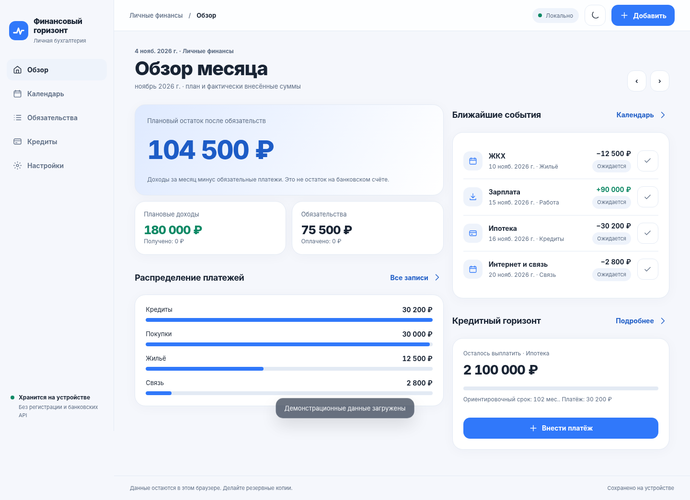
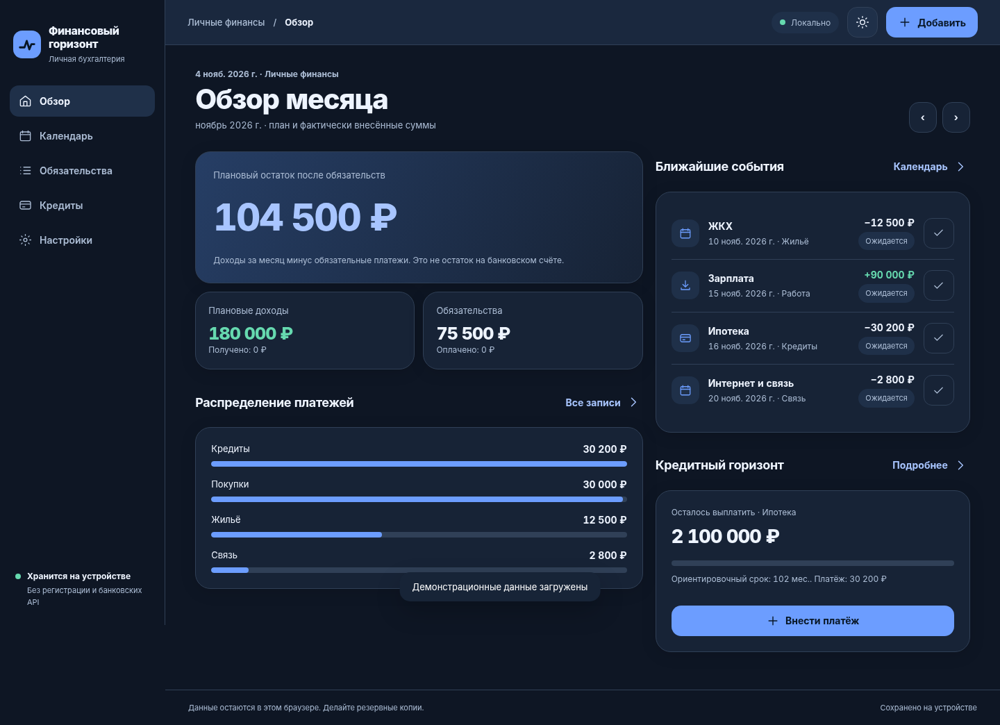
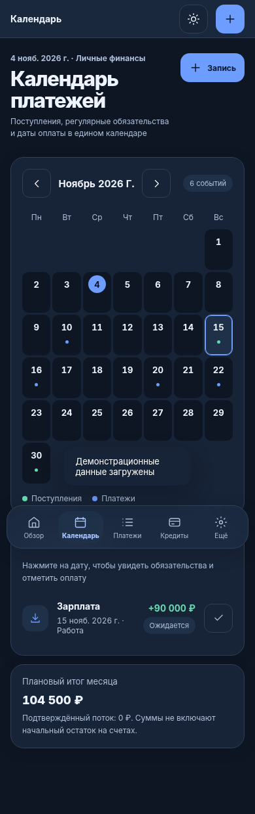
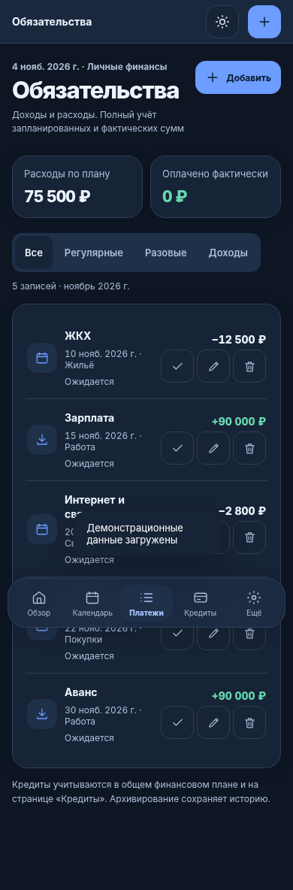

<picture>
  <source media="(prefers-color-scheme: dark)" srcset="assets/brand/logo-dark.svg">
  
</picture>

<h1>Личные финансы под контролем</h1>

Доходы, расходы, регулярные платежи и кредиты в одном удобном приложении. 
Без банковских подключений и обязательной регистрации. На телефоне и компьютере.

  <a href="https://fin-horizon.mikemoore.top/?guest=1"><strong>Попробовать без регистрации</strong></a>
  &nbsp;·&nbsp;
  <a href="#возможности">Возможности</a>
  &nbsp;·&nbsp;
  <a href="#быстрый-старт">Запустить локально</a>
  &nbsp;·&nbsp;
  <a href="README.en.md">English</a>

  
   
  PWA · IndexedDB · JavaScript · FastAPI · Без обязательной регистрации

---

## Приложение в действии

Светлая и тёмная темы, адаптивная компоновка для больших экранов и мобильная PWA. На скриншотах используются демонстрационные данные.

<table>
  <tr>
    <td align="center" width="50%">
      
       Обзор · светлая тема
    </td>
    <td align="center" width="50%">
      
       Обзор · тёмная тема
    </td>
  </tr>
  <tr>
    <td align="center">
      
       Календарь · мобильная версия
    </td>
    <td align="center">
      
       Платежи · мобильная версия
    </td>
  </tr>
</table>

## Возможности

| | Что можно делать |
| --- | --- |
| **Бюджет и обзор** | Учитывать доходы и расходы, категории, плановые и фактически внесённые суммы. |
| **Календарь платежей** | Видеть предстоящие обязательства, фиксировать полную или частичную оплату и отменять ошибочные операции. |
| **Регулярные записи** | Планировать разовые и повторяющиеся поступления и расходы. |
| **Кредиты** | Учитывать остаток долга, платежи и досрочное погашение с прогнозом уменьшения срока или ежемесячного платежа. |
| **Импорт** | Загружать совместимые XLSX-таблицы с предварительным просмотром и защитой от дублей; добавлять CSV-графики кредитов для сверки. |
| **Резервные копии** | Экспортировать и восстанавливать данные из файла, зашифрованного AES-256-GCM. |
| **PWA** | Установить приложение на устройство, переключать светлую и тёмную темы, работать с локальными записями при недоступной сети после первоначальной загрузки оболочки. |

Записи можно создавать, редактировать, архивировать и восстанавливать. Демонстрационный бюджет загружается **только по запросу пользователя**.

## Ваши данные - под вашим контролем

Financial Horizon построен по принципу **local-first**:

- Финансовые записи находятся в **IndexedDB конкретного браузера, профиля и сайта**. Приложение не отправляет их на сервер и не подключается к банковским счетам.
- **Регистрация не обязательна.** Можно сразу открыть гостевой режим. Сервис email-аккаунтов реализован отдельно и пока доступен в ограниченном режиме; публичное открытие регистрации зависит от [проверки безопасности #51](https://github.com/MikeMoore1337/financial-horizon/issues/51).
- Аккаунт **не синхронизирует бюджет между устройствами**. Backend хранит данные авторизации и сессий, а не финансовые операции.
- Скачиваемые резервные копии шифруются. **Сами записи в IndexedDB не зашифрованы приложением** - для сохранности данных используйте защищённый профиль устройства и регулярно создавайте копии.
- Офлайн-кэш Service Worker содержит файлы приложения, **не** финансовые записи.

> **Важно:** расчёт кредитов - ориентировочная аннуитетная модель, а не точный график конкретного банка. Реальные проценты, комиссии и даты списаний могут отличаться.

## Быстрый старт

Для знакомства с приложением достаточно перейти в [гостевой режим](https://fin-horizon.mikemoore.top/?guest=1). Для запуска исходников локально:

~~~bash
git clone https://github.com/MikeMoore1337/financial-horizon.git
cd financial-horizon
python3 -m http.server 8765 --bind 127.0.0.1
~~~

Откройте **http://127.0.0.1:8765/** и выберите «Продолжить без регистрации». В Windows вместо `python3` можно использовать `py`. Для гостевого режима backend авторизации не требуется. Не открывайте `index.html` через `file://` - используйте локальный HTTP-сервер.

Для установки как PWA в публичном интернете требуется HTTPS. Локальное и установленное приложения, а также разные браузеры, могут иметь **разные хранилища** - перенести данные можно через зашифрованный экспорт и импорт.

## Технологии и устройство проекта

| Уровень | Реализация |
| --- | --- |
| Интерфейс | HTML, CSS, JavaScript (ES-модули), адаптивная PWA без обязательной сборки фронтенда |
| Данные | IndexedDB, версионируемые миграции и защита от конфликтов записи |
| Резервирование | Web Crypto API, AES-256-GCM, PBKDF2-SHA256 |
| Офлайн | Web App Manifest и Service Worker |
| Необязательная авторизация | Python, FastAPI, SQLite, Argon2id, внешняя TLS-почта и Turnstile |
| Проверки | Node.js test runner, pytest, Playwright с настоящими IndexedDB, Service Worker, FastAPI и SQLite; GitHub Actions |

<strong>Структура репозитория и команды проверки</strong>

~~~text
index.html / app.js / styles.css   Интерфейс
finance.js / ledger-operations.js  Финансовые расчёты и операции
storage.js / state-migrations.js   IndexedDB и миграции
backup.js / excel-import.js        Резервные копии и импорт
account.html / account.js          Авторизация
backend/fh_email_auth/             Независимый backend email-аккаунтов
tests/ и backend/tests/            Модульные и браузерные проверки
docs/                               Техническая и эксплуатационная документация
deploy/                             Пример конфигурации размещения
~~~

**Модульные и серверные тесты** (Node.js 24, Python 3.12+):

~~~bash
npm ci
npm test
python3 -m pip install -r backend/requirements-test.txt
python3 -m pytest -q backend/tests/
~~~

**Реальные браузерные E2E** (Linux, Chromium):

~~~bash
npx playwright install --with-deps chromium
FH_E2E_PYTHON=python3 npm run test:e2e
~~~

E2E поднимают изолированный тестовый FastAPI/SQLite и используют синтетические данные. Подробные инструкции для Linux и Windows: [docs/E2E.md](docs/E2E.md). CI запускает проверки автоматически для PR в `main`.

## Развитие проекта

Проект развивается публично; готовые функции отделены от ещё не включённых:

- **Сделано:** локальный учёт, кредитные расчёты, импорт, шифрованные копии, PWA, версионируемые миграции и реальные E2E-тесты.
- **Перед публичным открытием:** [независимая приёмка безопасности email-регистрации #51](https://github.com/MikeMoore1337/financial-horizon/issues/51).
- **В разработке:** [синхронизация между устройствами #7](https://github.com/MikeMoore1337/financial-horizon/issues/7), [OAuth через внешних провайдеров #9](https://github.com/MikeMoore1337/financial-horizon/issues/9).
- **Качество интерфейса:** [доработки доступности и PWA #44](https://github.com/MikeMoore1337/financial-horizon/issues/44).

Актуальные планы и проблемы - в [GitHub Issues](https://github.com/MikeMoore1337/financial-horizon/issues). Наличие кода или зелёных тестов само по себе не означает, что функция включена для всех пользователей.

## Документация

[Импорт из Excel](docs/EXCEL_IMPORT.md) ·
[Модель данных и миграции](docs/DATA_MODEL.md) ·
[Реальные E2E-тесты](docs/E2E.md) ·
[Email-авторизация и эксплуатация](docs/EMAIL_AUTH_OPERATIONS.md) ·
[Фирменные ресурсы](docs/BRANDING.md)

Предложения и сообщения об ошибках можно оставить в [Issues](https://github.com/MikeMoore1337/financial-horizon/issues). Не публикуйте там пароли, токены, финансовые записи или другие личные данные.

---

  Финансовый горизонт · Удобный учёт сегодня, ясный взгляд на завтра.

