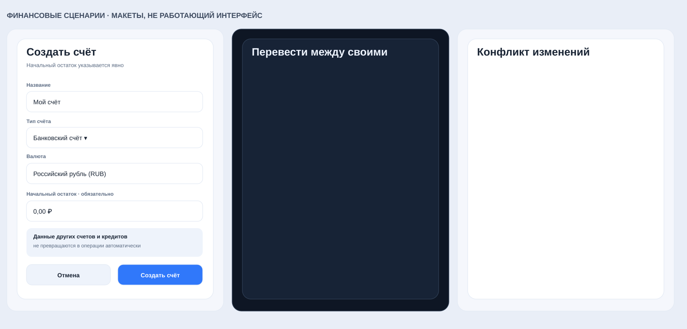

# Financial Horizon #33 - макеты счетов (на утверждение)

**Статус: DESIGN APPROVED / FEATURE OFF.** Владелец явно принял этот макет 08.11.2026 в ChatGPT. Это статические макеты, а не подтверждение реализации API/IndexedDB, работоспособности cloud или production. UI реализуется изолированно в PR #120, но не подключён к пользовательской навигации.

## Согласование

- Макеты для двух разрешённых тем. Цвета и типографика взяты из действующих переменных `styles.css`: синий акцент, матовые поверхности, светлая и тёмная темы.
- Переход из **«Обзора»**; на мобильном внизу остаются ровно пять имеющихся пунктов. Шестой таб и изменение действующей навигации не предлагаются.
- **«Всего на счетах»** - фактические остатки: `opening_minor + confirmed postings`; **«Доступно»** отдельно вычитает распределённые резервы. Плановые поступления и обязательства не прибавляются к наличным средствам. Использованы только вымышленные суммы: 135 000 + 80 000 + 5 000 = 220 000 ₽; резерв 30 000 ₽; доступно 190 000 ₽.
- Архивные счета свернуты, но сохраняют проводки и историю. Действия «История», «Перевести», «Изменить» - визуальные заглушки. В реальном UX кнопка «Перевести» должна открывать подтверждение суммы, двух счетов, двух остатков до/после и неизменности общего объёма активов.
- Создание счёта обязано требовать **явный** начальный остаток (включая ноль или отрицательное значение в допустимых пределах); направление сделки и сумма проходят безопасную minor-unit валидацию.
- Для сетевого сценария перевод нельзя объявлять выполненным до серверного подтверждения. Конфликт `409/412` и отсутствие сети должны отображаться без потери локальных данных. Связанное списание обязательства/кредита не удваивает движения.
- Русский текст, системные SVG-иконки и 44px минимум на реальные элементы управления должны быть проверены при отдельной реализации; эти статические картинки сами по себе не являются WCAG/браузерной приёмкой.

## Решение перед внедрением

**Макет принят владельцем.** Реализация экранов доступна для технической проверки в [PR #120](https://github.com/MikeMoore1337/financial-horizon/pull/120) (зависит от расчётного ядра PR #84), без активации в приложении. Отдельно необходимы утверждённый контракт API (#67), защищённая PostgreSQL (#66), безопасная синхронизация (#68), добровольная миграция (#69), независимая приёмка (#70) и security gate #51. **Не включать публичные финансовые функции до выполнения release gate.**
