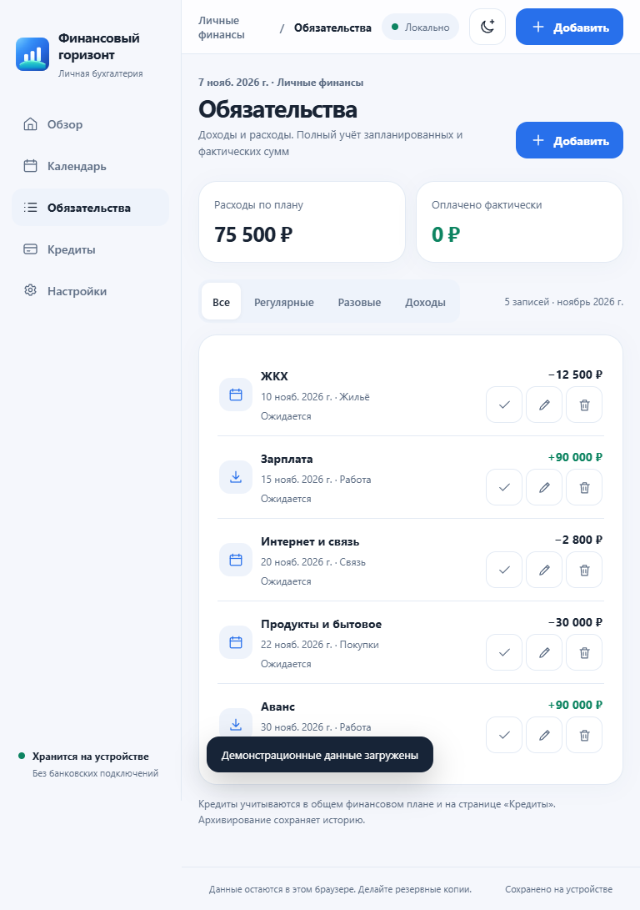
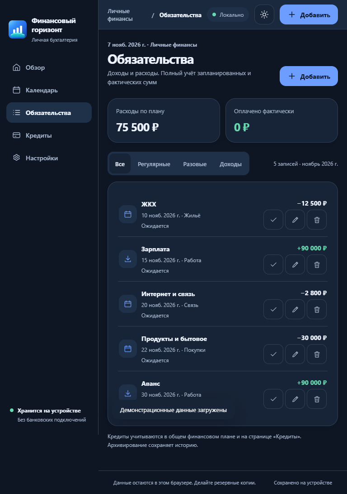
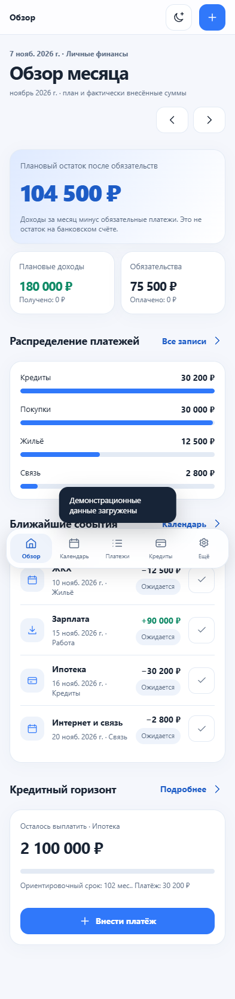
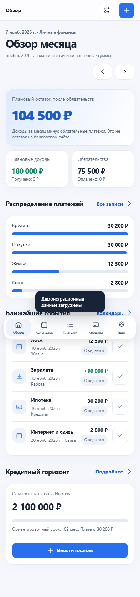
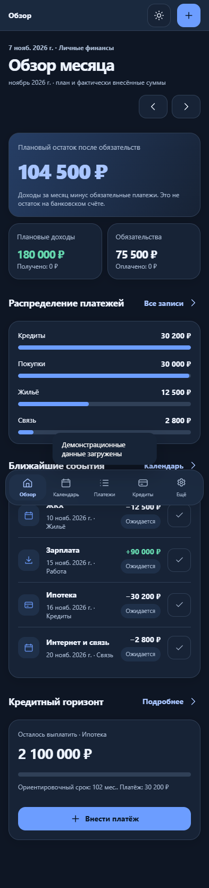
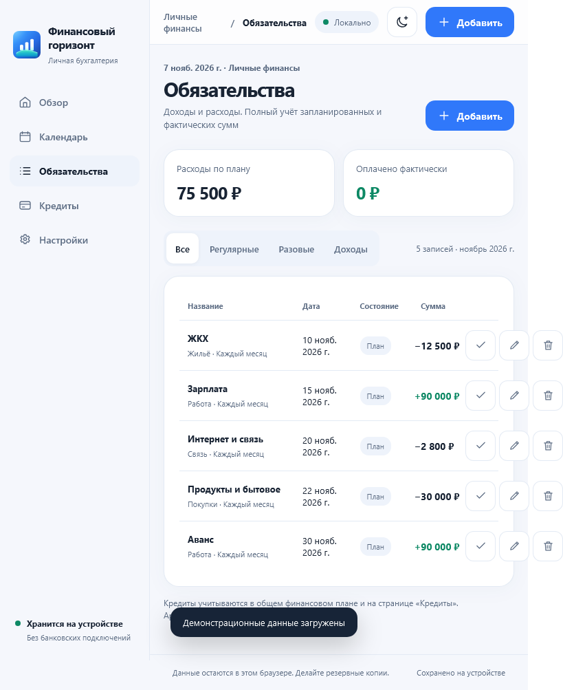
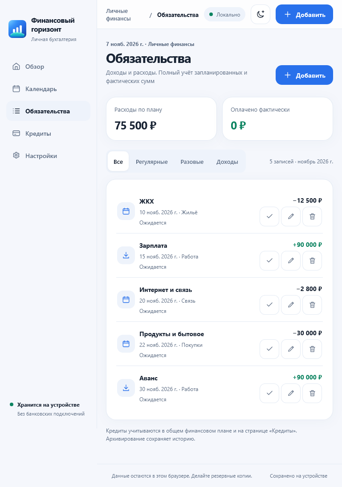

# Financial Horizon #44 - проверенное предложение устранения UX-дефектов (вариант A)

**Статус:** \`VISUAL_PROPOSAL_ONLY / NOT_APPROVED / NOT_DEPLOYED\`  
**Исходный код:** \`main@ea1127bde8f1f263fbc3223d8d8c8e7e01f9d009\` (финансовая схема v2)  
**Дата:** 2026-11-07  
**Назначение:** продемонстрировать минимальные изменения компоновки и семантики, которые могут закрыть подтверждённые UX44-02...09, не нарушая строгие границы независимого аудита.

**Важно:** ни один HTML/CSS/JS-файл приложения не менялся. Все изменения применены только к *памяти изолированного Chromium* через \`page.addStyleTag\` и изменение DOM после загрузки. Это не утверждённый дизайн и не релиз.

## 1. Визуальное сравнение: раздел «Обязательства», 768 px

**Исходный интерфейс:** таблица шире окна; правые действия выходят за границу, \`document.scrollWidth=819\` при \`viewport=768\`.

**Кандидат A:** использовать уже существующую мобильную разметку \`.records-mobile\` с карточными строками на промежуточных ширинах 761-1150 px. Боковая навигация остаётся на месте; никаких новых компонентов, модальных меню или кнопок. \`scrollWidth=768\`, все три действия каждой строки видимы.

**Почему выбран этот подход:** карточки уже присутствуют в текущем \`app.js\`; не приходится создавать второй CRUD или обрезать таблицу через \`overflow-x:hidden\`. Нужно отдельно проверить пограничные ширины 760/761/820/900/1000/1001/1024/1100/1120/1140/1150/1151 px и длинные финансовые названия перед внедрением.

## 2. Цвета и доступность мобильного интерфейса

Текущее светлое оформление содержит сочетания с контрастом ниже 4,5:1. Точечный вариант с сохранением синей и зелёной фирменной палитры:

| Назначение | Текущий цвет | Кандидат | Автоматический результат |
| --- | --- | --- | --- |
| Основной синий \`--accent\` | \`#3078fa\` | \`#2870eb\` | Нарушение \`color-contrast\` исчезло на проверенных экранах |
| Зелёный текст доходов \`--green\` | \`#0e8965\` | \`#0d8461\` | Нарушение \`color-contrast\` исчезло |
| Неактивный пункт мобильной панели | \`--sub\` / полупрозрачный фон | \`#41536c\` только для light dock | Устранено дополнительное ложное/пограничное состояние контраста на экране кредитов |

Тёмная тема при проверке сохранила исходные цвета. Для мобильного \`#top-add\` использован постоянный \`aria-label="Добавить запись"\`; декоративный SVG скрыт от скринридера.

## 3. Предлагаемый локальный CSS

Это **образец для будущего отдельного утверждённого исправления**, а не прямое изменение production-файла.

~~~css
body[data-theme="light"] {
  --accent: #2870eb;
  --green: #0d8461;
}

body[data-theme="light"] .bottom-nav button:not(.active) {
  color: #41536c;
}

@media (min-width: 761px) and (max-width: 1150px) {
  .records-table { display: none; }
  .records-mobile { display: block; }
  .record-mobile-row {
    display: flex;
    align-items: center;
    gap: 10px;
    padding: 15px 2px;
    border-bottom: 1px solid var(--line);
  }
  .record-mobile-row:last-child { border-bottom: 0; }
  .record-mobile-row > div:nth-child(2) { min-width: 0; flex: 1; }
  .record-mobile-row strong { font-size: 14px; }
  .record-mobile-row small {
    display: block;
    margin-top: 7px;
    font-size: 12px;
    color: var(--sub);
  }
  .record-mobile-amount {
    font-size: 14px;
    font-weight: 760;
    text-align: right;
    white-space: nowrap;
  }
  .record-mobile-actions {
    display: flex;
    gap: 4px;
    justify-content: flex-end;
    margin-top: 5px;
  }
}
~~~

Не копировать CSS в production без обычного процесса приёмки. Для релиза необходимо сохранить версионирование ресурсов HTML, CSS, Service Worker и откат, как требует проект.

## 4. Остальные нарушения семантики: проверенные направления

| Дефект | Изолированная проверка | Что нужно уточнить при реализации |
| --- | --- | --- |
| UX44-06, прокрутка XLSX | Внутреннему \`#excel-import-items\` временно заданы \`tabIndex=0\`, \`role=region\`, понятная подпись; axe \`scrollable-region-focusable\` перестал срабатывать | Убедиться, что Tab/ArrowDown/PageDown не создают двух конкурирующих областей прокрутки и VoiceOver читает список |
| UX44-07, подписи дат | Доступное имя начиналось с \`textContent\` кнопки, дополненное полной датой; axe \`label-content-name-mismatch\` исчезло; визуальное выделение дополнено \`aria-pressed\` | **Не рекомендовать механически склеивать без пробелов \`textContent\` для продакшена**. Сделать осмысленное имя (день + события) и подробности через \`aria-describedby\`, затем проверить VoiceOver |
| UX44-08, Turnstile | Назначение \`role=group\` существующему контейнеру устранило \`aria-prohibited-attr\` в режиме reset | Проверить настоящий загруженный Turnstile: iframe, роль, управление клавиатурой и озвучивание ошибок |
| UX44-09, выбранный день | В изолированной модели использован \`aria-pressed\` по выбранному дню | Состояние должно обновляться при каждом выборе и после повторного рендеринга, а не только после единственной DOM-правки |

## 5. Доказательства и контрольные результаты

- [Before/after JSON для шести экранов и трёх специализированных сценариев](evidence-44/visual-44-before-after.json).
- [Независимый полный прогон варианта A - 60 состояний и 31 axe-проверка](evidence-44/visual-44-60x31.json).

**Фактический результат временного варианта:**

| Метрика | Результат |
| --- | --- |
| Матрица адаптивности (6 ширин × 2 темы × 5 экранов) | **60/60 выполнено; 0 переполнений** |
| axe (393/768/1440 px × 2 темы × 5 экранов + reset) | **31 проверка, 0 нарушений по выбранным правилам** |
| Необработанные ошибки JS | **0** |
| Ошибки переходов | **0** |
| Реальный Safari/VoiceOver | **NOT_RUN** |
| Production-сборка с исправлениями | **NOT_BUILT / NOT_DEPLOYED** |

Это не подтверждает всё соответствие WCAG 2.2 AA: axe не выявляет все препятствия клавиатуры, скринридеров, жестов и аппаратной safe area. Специальные кейсы Excel, реального Turnstile и физического VoiceOver остаются обязательными.

## 6. Решение перед внедрением

1. Представить владельцу вариант A для узкого desktop/tablet: строки существующей мобильной карточки вместо переполненной таблицы и минимальное затемнение цветов.
2. Только после визуального утверждения передать **отдельному потоку исправления #44** узкие CSS/HTML/JS-изменения. Сам независимый аудиторский поток не меняет production-файлы.
3. Пройти \`node --test\`, настоящие E2E в CI, axe, 320/360/393/760/761/768/820/900/1000/1001/1024/1440/2560 px, оба оформления, long-text, keyboard/Tab/Escape/focus, PWA offline/upgrade.
4. Выполнить настоящий Safari iOS/macOS и VoiceOver на доступном физическом устройстве; обновить статус в #44. Если Apple-устройство недоступно, честно оставить \`NOT_RUN\`, не считать Edge/WebKit проверкой физического Safari.

**Итог:** \`VISUAL_CANDIDATE_A_TESTED\`; \`OWNER_VISUAL_APPROVAL=NOT_GRANTED\`; \`PRODUCTION_UNCHANGED\`; \`ISSUE_44=OPEN\`.

## 7. Дополнительный WebKit 27.2 на Windows - НЕ физический Safari

Установлен официальный движок **Playwright WebKit 27.2 (Windows)** в отдельную QA-среду, без изменений проекта и production. Это дополнительная проверка совместимости, но **не Safari macOS/iOS, не VoiceOver и не аппаратные safe areas**.

| Этап | Проверка | Результат |
| --- | --- | --- |
| Исходный UI | 4 ширины (320/393/768/1440) × 2 темы × 5 экранов | **40/40 состояний**, воспроизведён overflow 819/768 в обеих темах |
| Исходный UI | axe в 393 и 768 px, обе темы × 5 экранов | **20 прогонов**, нарушения имён кнопок, контраста и названий календаря |
| Временный кандидат A | Те же 40 состояний | **40/40, ноль переполнений** |
| Временный кандидат A | Те же 20 axe-прогонов | **20/20 без нарушений** по включённым проверкам WCAG |
| JavaScript | Все прогоны | **0 необработанных ошибок** |

[Машинные результаты WebKit (Windows)](evidence-44/visual-44-webkit-windows.json)

**Наглядная проверка WebKit, 768 px:**

**Граница:** WebKit позволяет увидеть часть специфики движка, но не воспроизводит UI браузера Safari, поведение iOS с экранной клавиатурой, скринридер VoiceOver, переключение системной строки и работу реального устройства. Эти обязательные пункты #44 продолжают иметь статус \`NOT_RUN\`.

## 8. Граничная матрица ширин - важная корректировка порога

Дополнительное исследование обнаружило, что проблема не ограничивается 768 px: старая таблица выступала за ширину окна на **11 из 18** проверенных контрольных размеров от 760 до 1200 px. В частности, переполнение есть на 761, 768, 820, 900, 950, 1000, 1001, 1024, 1050, 1100 и 1120 px. Первоначальный прототип с \`max-width:1000px\` **не устранял проблему на 1001-1120 px** и не должен был считаться достаточным.

Поэтому кандидат А скорректирован до временного правила **\`min-width:761px\` - \`max-width:1150px\`**:

- На 760 px работает существующий мобильный набор карточек.
- На 761-1150 px предлагается существующая карточная разметка при сохранённой desktop-боковой панели.
- На 1151 px и шире возвращается существующая таблица.
- **18/18** повторных измерений после такого переключения не обнаружили горизонтальной прокрутки (до исправления - **11/18** с переполнением).

[Все исходные и исправленные измерения по 18 ширинам](evidence-44/visual-44-boundary-18.json).

Рекомендуется проверить дополнительно 200% масштаб текста и длинные названия, так как критическая ширина зависит от системных шрифтов и браузера. Визуальный порог и использование мобильных строк на настольном устройстве **требуют явного решения владельца**.

